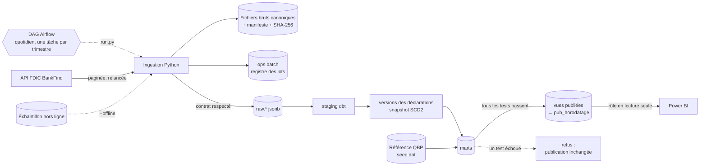

# Entrepôt de données bancaires FDIC


*[English version](README.md)*

Cet entrepôt charge dans PostgreSQL les déclarations trimestrielles d'environ 4 400 banques américaines, publiées par la FDIC. Chaque chiffre remonte jusqu'au fichier et au lot qui l'ont chargé. Rejouer un fichier ne duplique jamais les données. Une valeur révisée devient une nouvelle version sans effacer l'ancienne. Le tableau de bord ne lit que ce qui a passé tous les tests : un build en échec laisse intact le dernier état publié.

## En bref

| | |
|---|---|
| **Couverture** | 26 559 déclarations trimestrielles de 4 547 banques, du T1 2025 au T2 2026 ; 27 835 établissements ; 4 117 faillites depuis 1934 |
| **Technologies** | Python 3.12, PostgreSQL 16, dbt 1.12, Airflow 3.3, Power BI, Docker Compose |
| **Qualité** | un contrat de données vérifié avant chaque chargement, 65 tests de données dbt qui conditionnent la publication, 64 tests Python |
| **Rapprochement** | 12 contrôles sur 12 à moins de 0,5 % du Quarterly Banking Profile de la FDIC |
| **Alerte précoce** | 4 des 5 faillites bancaires de 2025-2026 portaient au moins deux signaux dans leur dernière déclaration |
| **Exploitation** | une exécution Airflow quotidienne, une fenêtre de révision hebdomadaire, le retour à la publication précédente en une commande |

## Documentation

| Document | Contenu |
|---|---|
| [Documentation dbt](https://ouchchenomar.github.io/fdic-bank-data-warehouse/) | chaque modèle et chaque colonne, avec le graphe de lignage |
| [Cahier des charges](docs/specification.fr.md) | exigences, modèle de données et critères de recette |
| [Procès-verbal de recette](docs/recette.fr.md) | chaque test de recette avec son résultat sur données réelles |
| [Guide d'exploitation](docs/runbook.fr.md) | exploitation courante, incidents et reprise |
| [Décisions d'architecture](docs/adr) | quatre ADR : idempotence, versions, publication contrôlée, orchestration (en anglais) |
| [Journal des versions](CHANGELOG.md) | notes de version (en anglais) |

## Architecture



1. **Extraction.** Pages de 1 000 lignes, triées sur une clé stable. Relance avec attente croissante sur les erreurs 429, 5xx et réseau, en respectant `Retry-After`. Si la FDIC reconstruit son index pendant la pagination, le lot est refusé.
2. **Archivage.** Chaque lot écrit un fichier JSON Lines canonique (même contenu, mêmes octets) et un manifeste : URL, paramètres, total annoncé, version de la source, version du contrat et SHA-256.
3. **Contrôle.** Avant tout chargement, le lot est vérifié contre le [contrat de données](contracts/fdic.yml) : champs du contrat, clés non vides et uniques, types, formats de date et total annoncé.
4. **Chargement.** Si l'empreinte du fichier est celle du dernier lot chargé, la tentative est tracée comme `duplicate` et rien n'est chargé. Sinon, les lignes sont copiées dans `raw.*` dans la même transaction que le statut `loaded`.
5. **Staging (dbt).** Typage, noms métier avec suffixe d'unité (`_kusd`, `_pct`) et tests.
6. **Versions (DWH-04).** Chaque contenu distinct d'une déclaration est une version, avec la raison de son existence :
   - `initial` : premier chargement ;
   - `contract_change` : le contrat a ajouté des champs, aucune valeur n'a changé ;
   - `revision` : la FDIC a modifié une valeur ;
   - `simulated` et `restored_after_simulation` : une correction de test et son annulation.
7. **Marts.** Faits, dimensions et rapports, décrits dans [le modèle de données publié](#modèle-de-données-publié).
8. **Publication contrôlée (DWH-05).** `run.py publish` lance `dbt build` :
   - si un test échoue, la tentative est tracée comme `refused` et les vues publiées ne changent pas ;
   - sinon, les marts sont copiés dans un nouveau schéma `pub_<horodatage>`, et les vues du schéma `published` basculent dessus dans une seule transaction ;
   - les trois dernières publications sont conservées, et `publish --rollback` revient à la précédente.
9. **Orchestration.** Un DAG Airflow lance les mêmes commandes `run.py` qu'un opérateur, voir [Exploitation](#exploitation).
10. **Tableau de bord.** Power BI lit les vues `published` avec le rôle `fdic_reader`, qui ne peut rien lire d'autre.

## Modèle de données publié

Le schéma `published` contient dix vues. Les montants sont en milliers de dollars (`_kusd`), les ratios en pourcentage (`_pct`).

| Vue | Une ligne par | Contenu |
|---|---|---|
| `fct_filings` | banque et trimestre, version courante | bilan, résultat, ratios publiés, flux trimestriels tirés des montants cumulés, signaux d'alerte, lignage (lot, version de l'index FDIC, version du contrat) |
| `fct_filing_versions` | contenu distinct d'une déclaration | numéro de version, raison, champs modifiés, lot source |
| `rpt_filing_revisions` | champ modifié entre deux versions | ancienne valeur, nouvelle valeur, écart |
| `dim_institution` | établissement (CERT) | nom, localisation, classe, régulateur, dates clés |
| `dim_institution_history` | établissement et période de validité | historique SCD2 des attributs, construit par un snapshot dbt |
| `fct_failures` | faillite depuis 1934 | date, perte estimée, dernière déclaration de la banque avant sa chute |
| `rpt_failure_signals` | déclaration d'une banque défaillante avant sa faillite | les trois signaux d'alerte |
| `rpt_watchlist` | banque du dernier trimestre avec au moins deux signaux | signaux, ratios, signaux du trimestre précédent |
| `rpt_reconciliation_qbp` | trimestre et mesure | Quarterly Banking Profile de la FDIC contre l'entrepôt, écart et statut |
| `rpt_batches` | lot | registre de chaque tentative d'extraction, avec son statut |

## Tableau de bord

`python powerbi/build_powerbi.py` génère le projet Power BI à partir du schéma publié : un modèle sémantique TMDL (9 tables, 6 relations, 19 mesures) et un rapport PBIR de quatre pages.

| Page | Contenu |
|---|---|
| Vue d'ensemble | actifs, dépôts et résultat trimestriel du secteur, filtres par trimestre, État et taille, principales banques |
| Fiche établissement | une banque, atteinte par clic droit sur n'importe quelle banque des autres pages, puis *Extraire* : chaque chiffre avec son lot source, les versions de chaque déclaration et les valeurs modifiées |
| Alerte précoce | les déclarations des banques défaillantes avant leur faillite, et la liste de surveillance du dernier trimestre |
| Qualité et lignage | rapprochement avec le Quarterly Banking Profile, lots par statut, registre des lots |

## Démarrage

Prérequis : Python 3.12 ou plus, Docker.

```bash
python -m venv .venv
.venv/Scripts/python -m pip install -r requirements-dev.txt   # Linux/macOS : .venv/bin/python
cp .env.example .env            # puis définir les mots de passe
docker compose up -d            # PostgreSQL 16 sur 127.0.0.1:5435
```

Ensuite, avec le Python de l'environnement virtuel :

```bash
python run.py db-init                                       # schémas ops et raw, journal des publications
python run.py ingest financials --quarters 2025Q1:2026Q2    # un lot par trimestre
python run.py ingest institutions
python run.py ingest failures
python run.py publish                                       # dbt build, puis publication
python run.py report                                        # registre des lots
python run.py publications                                  # journal des publications
```

**Sans internet**, sur une base vide, on charge l'échantillon versionné, puis on publie. L'échantillon est construit sur 14 CERT : les cinq plus grandes banques, les six faillites de 2025-2026, et trois cas limites (dépôts nuls, prêts nuls, une société fiduciaire absente de `/institutions`).

```bash
python run.py ingest all --quarters 2025Q1:2026Q2 --offline
python run.py publish
```

**Power BI.** Ouvrir `powerbi/FDIC.pbip` dans Power BI Desktop et l'actualiser avec l'utilisateur `fdic_reader` et le mot de passe `FDIC_READER_PASSWORD` du fichier `.env`.

## Exploitation

```bash
docker compose --profile airflow up -d airflow                    # Airflow 3.3 sur http://127.0.0.1:8096
docker compose exec airflow airflow dags unpause fdic_warehouse   # en pause à sa création
```

Le DAG `fdic_warehouse` tourne tous les jours à 07:00 UTC :
- il extrait les établissements, les faillites, et chaque trimestre terminé depuis le dernier chargé, avec une tâche par trimestre ;
- le lundi, il réextrait aussi les quatre derniers trimestres, pour capter les révisions ;
- puis il publie, édite le registre des lots et contrôle la fraîcheur des sources.

Un trimestre que la FDIC n'a pas encore publié finit en *skipped*, pas en échec. Chaque tâche lance une commande `run.py`, la même qu'à la main ([ADR 0004](docs/adr/0004-airflow-orchestration-of-cli-commands.md)). Une exécution manquée pendant que la machine était éteinte est rattrapée au redémarrage, et les deux conteneurs redémarrent avec Docker. Exécution du 13/11/2026, 53 secondes du début à la fin :

```text
migrate                  success
ingest_institutions      success   [duplicate] 27 835 lignes, même fichier que le dernier lot : rien de chargé
ingest_failures          success   [duplicate] 4 117 lignes
plan_quarters            success   ["2026Q3"]
ingest_quarter[2026Q3]   skipped   the source announces 0 rows for this partition (not published yet?)
publish                  success   [published] pub_20261113T130802855z
report, check_freshness  success
```

Le [guide d'exploitation](docs/runbook.fr.md) décrit comment relancer un trimestre, rejouer un lot, restaurer l'état publié, et ce que signifie chaque message d'erreur du pipeline.

## Qualité et tests

- **Contrat de données.** [contracts/fdic.yml](contracts/fdic.yml) (version 2) fixe pour chaque champ le type, l'unité, la nullabilité et le sens. Chaque champ a été vérifié sur l'API réelle. Un lot qui ne le respecte pas est refusé et tracé avec sa raison.
- **Tests dbt.** 65 tests de données passent avant chaque publication : clés, relations, valeurs admises, ratios publiés contre leurs composantes, flux trimestriels dont la somme égale le cumul, et aucune valeur simulée dans les données publiées.
- **Tests Python.** 64 tests : tests unitaires, client HTTP simulé, et tests sur PostgreSQL.
- **Une seule commande.** `python run.py check` lance le linter, les tests, et un parcours complet hors ligne (échantillon, dbt build, publication) dans une base jetable. Le workflow GitHub Actions lance le même contrôle à la demande, et des hooks pre-commit vérifient chaque commit.

## Résultats sur données réelles

### Ce que les données ont montré

Constats tirés des exécutions du 12/11/2026. Chacun est traité dans le code ou les tests.

- **Unités.** Les montants sont en milliers de dollars : l'`ASSET` de Wells Fargo, 1 907 928 000, vaut 1 908 milliards de dollars.
- **Résultat cumulé.** `NETINC` est cumulé depuis le 1er janvier. Le résultat du T2 2026 de Wells Fargo vaut 12 808 000 − 5 961 000 = 6 847 000 milliers de dollars, et non 12 808 000. `fct_filings` calcule le flux du trimestre.
- **Les ratios publiés concordent avec leurs composantes.** 52 769 contrôles comparent EQ / ASSET à `EQV` et LNLSNET / DEP à `LNLSDEPR`, sans aucun écart supérieur à 0,01 point. La FDIC publie 0 quand les dépôts sont nuls : les 349 déclarations sans dépôts sont donc écartées du contrôle. 340 d'entre elles viennent de sociétés fiduciaires (classe NC).
- **Les 57 déclarants absents de `/institutions` sont des sociétés fiduciaires.** 57 banques (332 déclarations) figurent dans `/financials` mais pas dans `/institutions`. Toutes ont la classe NC : ce sont surtout des trust companies non assurées, comme BlackRock Institutional Trust Company. La version 2 du contrat ajoute le nom, l'État, la ville et la classe déclarés avec chaque déclaration, et `dim_institution` les utilise pour ces 57 CERT.
- **Ajouter un champ n'est pas une révision.** Après le changement de contrat, les six trimestres ont été rechargés, et les 26 559 déclarations ont reçu une deuxième version. Elle est étiquetée `contract_change`, avec 0 valeur modifiée, car une version n'est comparée que sur les champs présents des deux côtés.
- **La clé des faillites a dû changer.** 488 faillites de 1934 à 1976 n'ont pas de CERT, et 44 CERT ont fait faillite deux fois. Le contrat a refusé le premier lot. La clé est désormais l'identifiant d'enregistrement FDIC (`ID`). Comme on ne peut ni le demander ni trier dessus, cette petite table est lue en une seule page.
- **Formats de date différents.** `REPDTE` vaut `20260630` dans `/financials` et `06/30/2026` dans `/institutions`. `FAILDATE` vaut `5/1/2026`.

### Alerte précoce, testée sur les faillites réelles

Chaque déclaration porte trois signaux (DWH-08). Les seuils sont des variables dbt :
- **fonds propres** : ratio de levier Tier 1 sous 5 % ;
- **qualité des actifs** : prêts non performants au-dessus de 5 % des prêts ;
- **rentabilité** : ROA négatif.

`rpt_failure_signals` reprend toutes les déclarations d'une banque défaillante avant sa faillite. Cinq des six faillites de 2025-2026 ont au moins une déclaration dans l'entrepôt. La sixième, Pulaski Savings Bank, a fait faillite le 17/01/2025, avant le premier trimestre chargé.

| Banque (CERT) | Faillite | Signaux dans sa dernière déclaration | Première déclaration avec 2 signaux ou plus |
|---|---|---|---|
| Metropolitan Capital B&T (57488) | 30/01/2026 | 2 (T4 2025) | T1 2025, 4 trimestres avant |
| Community Bank and Trust – West Georgia (25796) | 01/05/2026 | 3 (T1 2026) | T2 2025, 4 trimestres avant |
| Kentland FS&LA (28722) | 10/07/2026 | 3 (T1 2026) | T1 2025, 5 trimestres avant |
| Small Business Bank (25744) | 17/07/2026 | 2 (T1 2026) | T1 2026, 1 trimestre avant |
| Santa Anna National Bank (5520) | 27/06/2025 | 0 (T1 2025) | aucune |

Community Bank and Trust est le cas de référence du cahier des charges. Au 31/03/2026, elle affiche 17,3 % de prêts non performants, des fonds propres à 1,3 % des actifs et un ROA de −6,9 %.

Au T2 2026, la liste de surveillance (`rpt_watchlist`) compte 24 banques avec au moins deux signaux. Trois portent les trois signaux, et sept en ont plus qu'au trimestre précédent.

Le filtre ne porte que sur les établissements assurés, la population du QBP. Les succursales de banques étrangères (classe OI) et les sociétés fiduciaires non assurées (classe NC) n'ont pas de fonds propres propres et déclarent Tier 1, fonds propres et ROA à 0. Lus comme des valeurs, ces zéros placeraient l'activité américaine de Bank of China sur la liste, avec un faux signal de fonds propres.

### Rapprochement avec le Quarterly Banking Profile (REC-02)

Chaque trimestre, la FDIC publie les totaux du secteur dans son Quarterly Banking Profile (QBP). Le seed dbt `qbp_reference` reprend deux chiffres des communiqués QBP pour six trimestres, chacun avec son URL : le nombre d'établissements assurés et le résultat net du trimestre. `rpt_reconciliation_qbp` les compare aux déclarations publiées :

| Trimestre | Établissements assurés, QBP / entrepôt | Résultat net en Md$, QBP / entrepôt |
|---|---|---|
| T1 2025 | 4 462 / 4 462 | 70,6 / 70,41 (−0,27 %) |
| T2 2025 | 4 421 / 4 421 | 69,9 / 70,03 (+0,19 %) |
| T3 2025 | 4 379 / 4 379 | 79,3 / 79,32 |
| T4 2025 | 4 336 / 4 338 (+2) | 77,7 / 77,66 |
| T1 2026 | 4 278 / 4 279 (+1) | 80,5 / 80,45 |
| T2 2026 | 4 238 / 4 238 | 90,1 / 90,20 (+0,11 %) |

Les 12 contrôles sont dans la tolérance de 0,5 %, et 7 sont égaux à l'arrondi publié près. Les effectifs ne concordent qu'une fois deux classes écartées, car le QBP ne les compte pas parmi les établissements assurés : les sociétés fiduciaires non assurées (classe NC) et les succursales américaines assurées de banques étrangères (classe OI).

### Révision et contrôle de publication

Exécution du 12/11/2026 (scénario complet dans le [procès-verbal de recette](docs/recette.fr.md)). Une correction simulée augmente de 10 % les fonds propres de Wells Fargo au T2 2026, sans toucher au ratio publié :

```text
$ python run.py simulate-revision --quarter 2026Q2 --cert 3511 --field EQ --change-pct 10
[loaded   ] financials_20260630_20261112T195337261Z  announced=4313 extracted=4313 rejected=0 loaded=4313

$ python run.py publish
[refused] pub_20261112T195338892z
            published views unchanged: pub_20261112T195245220z
            dbt build failed: assert_no_simulated_value_is_published (fail: Got 4313 results, [...]);
            assert_published_ratios_match_components (fail: Got 1 result, [...])

$ python run.py ingest financials --quarters 2026Q2        # même SHA-256 qu'avant la simulation
$ python run.py publish
[published] pub_20261112T195413659z
```

L'historique garde chaque étape :

```text
 version | change_kind               | batch_mode | field | previous  | new       | delta
---------+---------------------------+------------+-------+-----------+-----------+-----------
       1 | initial                   | api        |       |           |           |
       2 | contract_change           | api        |       |           |           |
       3 | simulated                 | simulated  | EQ    | 169518000 | 186469800 |  16951800
       4 | restored_after_simulation | api        | EQ    | 186469800 | 169518000 | -16951800
```

### Registre des lots

`python run.py report` montre chaque tentative, y compris les refusées. Extrait du 12/11/2026 :

```text
batch_id                                  status     mode       announced  extracted  rejected  loaded
financials_20260630_20261112T195405170Z   loaded     api        4313       4313       0         4313
financials_20260630_20261112T195337261Z   loaded     simulated  4313       4313       0         4313
financials_20260630_20261112T195322904Z   duplicate  api        4313       4313       0         0
    same file as financials_20260630_20261112T194225991Z: nothing loaded
financials_20260930_20261112T194315128Z   failed     api        0          0          0
    error: the source announces 0 rows for this partition (not published yet?)
failures_all_20261112T192250099Z          failed     api        4117       4117       488
    error: row 1: key field CERT is empty; [...]
```

## Limites connues

- **Couverture.** Les déclarations commencent au T1 2025. Le T3 2026 n'était pas encore publié par la FDIC le 14/11/2026 ; l'exécution quotidienne le chargera dès sa publication.
- **Rapprochement par banque.** Le cahier des charges demande aussi de vérifier dix couples banque–trimestre avec les Call Reports du FFIEC. Ce contrôle n'est pas fait : les sites du FFIEC ont répondu HTTP 403 depuis le réseau utilisé pour ce projet. Le rapprochement au niveau du secteur, ci-dessus, est complet.
- **Alerte précoce.** Les seuils sont indicatifs, pas une notation prudentielle. Un filtre sur ratios manque une banque dont les déclarations paraissent saines jusqu'à sa faillite, comme le montre Santa Anna National Bank.

## Organisation du dépôt

```text
contracts/fdic.yml          contrat de données (champs, unités, clés, contrôles de ratios), version 2
sql/                        registre ops.batch, tables brutes, journal des publications, rôle en lecture seule
src/fdic_dwh/               client, sources, contrôles, pipeline, simulation, publication, CLI
dbt/models/staging/         vues typées sur les données brutes
dbt/models/intermediate/    versions des déclarations, derniers établissements
dbt/snapshots/              snapshot SCD2 des établissements
dbt/models/marts/           faits, dimensions, rapports d'alerte et de rapprochement publiés
dbt/seeds/                  chiffres de référence du Quarterly Banking Profile
dbt/tests/                  cohérence des ratios, flux trimestriels, aucune valeur simulée publiée
airflow/dags/               DAG fdic_warehouse
docker/airflow/             image Airflow, avec le projet dans son propre environnement virtuel
powerbi/                    projet Power BI (modèle TMDL, rapport PBIR) et le script qui le génère
data/sample/                échantillon hors ligne (versionné) ; data/raw/ n'est pas versionné
tests/                      tests unitaires, HTTP simulé et PostgreSQL
.github/workflows/ci.yml    le contrôle run.py check, lancé à la demande
docs/                       cahier des charges, procès-verbal de recette, guide d'exploitation et décisions d'architecture
```

## Source des données et licence

[API FDIC BankFind Suite](https://api.fdic.gov/banks/docs/) : données publiques de la Federal Deposit Insurance Corporation américaine, sans clé d'API. Les chiffres du rapprochement viennent des communiqués du Quarterly Banking Profile de la FDIC, listés avec leur URL dans [dbt/seeds/qbp_reference.csv](dbt/seeds/qbp_reference.csv).

Le code est sous [licence MIT](LICENSE), qui ne couvre pas les données.
