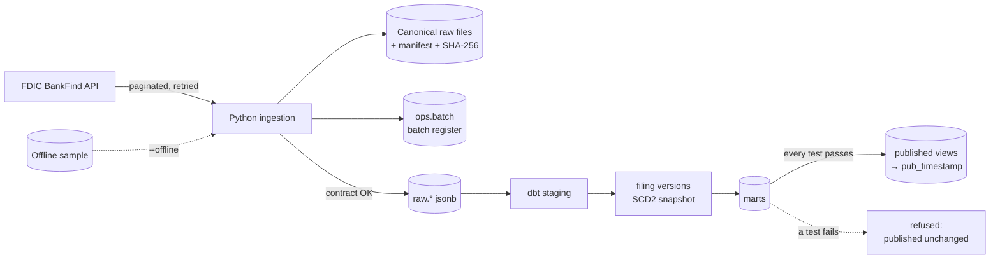

# FDIC Bank Data Warehouse

*[Version française](README.fr.md)*

This project ingests the quarterly filings of about 4,400 U.S. banks, published by the FDIC, into a PostgreSQL warehouse. Every figure can be traced back to the file and the run that loaded it. Replaying a file never duplicates data. A revised value becomes a new version without erasing the old one. The dashboard reads only what passed every test: a build that fails leaves the last published state untouched.

**Status (2026-11-12): weeks 1 and 2 of 3 are done.** Week 1 delivered ingestion, the batch register and the data contract. Week 2 added version history, the SCD2 dimension, quarterly flows, the marts and the gated publication. Everything runs on real data, and the test scenario is in [docs/recette.fr.md](docs/recette.fr.md) (French). The [roadmap](#roadmap) lists what comes next.

## What is loaded

| Dataset | FDIC endpoint | Content on 2026-11-12 |
|---|---|---|
| Quarterly filings | `/financials` | 26,559 filings from 4,547 banks, Q1 2025 → Q2 2026, 23 fields |
| Institutions | `/institutions` | 27,835 institutions, active or not |
| Failures | `/failures` | 4,117 failures and assistance cases since 1934 |

The data contract ([contracts/fdic.yml](contracts/fdic.yml), version 2) states each field's type, unit, nullability and meaning. Every field in it was checked against the live API.

## Architecture



1. **Extraction.** Pages of 1,000 rows are sorted on a stable key. On 429, 5xx and network errors the client retries with exponential backoff and honours `Retry-After`. If the FDIC rebuilds its index in the middle of a pagination, the batch is refused.
2. **Archiving.** Each batch writes a canonical JSON Lines file (same content, same bytes) and a manifest with the URL, parameters, announced total, source index version, contract version and SHA-256.
3. **Validation.** Before loading, each batch is checked for contract fields, non-empty unique keys, types and date formats, and the announced total.
4. **Loading.** If the file's hash equals the last loaded batch, the attempt is recorded as `duplicate` and nothing is loaded. Otherwise the rows are copied into `raw.*` in the same transaction as the `loaded` status.
5. **Staging (dbt).** Payloads are typed with business names and unit suffixes (`_kusd`, `_pct`) and tested.
6. **Versions (DWH-04).** Each distinct content of a filing is a version, labelled with the reason it exists:
   - `initial`: first load;
   - `contract_change`: the contract added fields, no value changed;
   - `revision`: the FDIC changed a value;
   - `simulated` and `restored_after_simulation`: a test correction and its undoing.

   `rpt_filing_revisions` shows each changed field with its previous value, new value and delta.
7. **Marts.**
   - `fct_filings` holds the current version of each filing, which comes from the latest loaded batch of its quarter. It adds quarterly flows derived from year-to-date amounts, and the lineage of every row: batch, FDIC index version and contract version.
   - `dim_institution` covers every CERT, and `dim_institution_history` is its SCD2 history, built by a dbt snapshot.
   - `fct_failures` adds each failed bank's last filing before its failure.
8. **Gated publication (DWH-05).** `run.py publish` runs `dbt build`:
   - If any test fails, the attempt is logged as `refused` and the published views do not change.
   - Otherwise the marts are copied to a new schema `pub_<timestamp>`, and the views of the `published` schema are switched to it in one transaction.
   - The last three publications are kept, and `publish --rollback` goes back to the previous one.

Design choices are recorded in [docs/adr](docs/adr). The full specification (in French) is [docs/specification.fr.md](docs/specification.fr.md).

## What the real data showed

These findings come from the runs of 2026-11-12. Each one is handled in the code or the tests.

- **Units.** Amounts are in thousands of dollars: Wells Fargo's `ASSET` = 1,907,928,000 means $1.9 trillion.
- **Year-to-date income.** `NETINC` is cumulated since January 1. Wells Fargo's Q2 2026 income is 12,808,000 − 5,961,000 = 6,847,000 (thousands of dollars), not 12,808,000. `fct_filings` computes the quarterly flow, and a dbt test checks that the flows of a year add up to its year-to-date amount.
- **Published ratios match their components.** 52,769 checks compare EQ / ASSET with `EQV` and LNLSNET / DEP with `LNLSDEPR`, and none is off by more than 0.01 point. When deposits are 0 the FDIC publishes a ratio of 0, so the 349 filings without deposits are skipped. 340 of them come from trust companies (class NC).
- **The 57 filers missing from `/institutions` are trust companies.** 57 banks (332 filings) appear in `/financials` but not in `/institutions`. All of them have class NC, mostly non-insured trust companies such as BlackRock Institutional Trust Company. Contract version 2 adds the name, state, city and class reported with each filing, and `dim_institution` uses them for these 57 CERTs.
- **Adding a field is not a revision.** After the contract change, the six quarters were reloaded and all 26,559 filings got a second version. They are labelled `contract_change` with 0 changed values, because a version is compared only on the fields present on both sides.
- **The failures key had to change.** 488 failures from 1934 to 1976 have no CERT, and 44 CERTs failed twice. The contract refused the first batch. The key is now the FDIC record ID, which cannot be requested or sorted on, so this small table is read in a single page.
- **A quarter not yet published is refused cleanly.** Q3 2026 still returned 0 rows on 2026-11-12: the batch is recorded as failed and nothing changes downstream.
- **No revision observed yet.** Extracting the last four quarters again on 2026-11-12 gave four duplicates.
- **Different date formats.** `REPDTE` is `20260630` in `/financials` and `06/30/2026` in `/institutions`. `FAILDATE` is `5/1/2026`.

## Quick start

Requirements: Python 3.12+, Docker.

```bash
python -m venv .venv
.venv/Scripts/python -m pip install -r requirements-dev.txt   # Linux/macOS: .venv/bin/python
cp .env.example .env            # then set POSTGRES_PASSWORD
docker compose up -d            # PostgreSQL 16 on 127.0.0.1:5435
```

Then, with the virtual environment's Python:

```bash
python run.py db-init                                       # ops and raw schemas, publication log
python run.py ingest financials --quarters 2025Q1:2026Q2    # one batch per quarter
python run.py ingest institutions
python run.py ingest failures
python run.py report                                        # batch register
python run.py publish                                       # dbt build (67 tests), then publish
python run.py publications                                  # publication log
python run.py ingest financials --last 4                    # extract the revision window again
python -m pytest                                            # 54 tests
```

**Without internet**, on an empty database, load the versioned sample, then publish. The sample is built from 14 CERTs:
- the five largest banks;
- the six failures of 2025-2026;
- three edge cases: zero deposits, zero loans, and a trust company absent from `/institutions`.

```bash
python run.py ingest all --quarters 2025Q1:2026Q2 --offline
python run.py publish
```

## Revision and publication gate, on real data

Run on 2026-11-12 (full scenario in [docs/recette.fr.md](docs/recette.fr.md)). A simulated correction raises Wells Fargo's equity by 10% for Q2 2026 without touching the published ratio:

```text
$ python run.py simulate-revision --quarter 2026Q2 --cert 3511 --field EQ --change-pct 10
[loaded   ] financials_20260630_20261112T195337261Z  announced=4313 extracted=4313 rejected=0 loaded=4313

$ python run.py publish
[refused] pub_20261112T195338892z
            published views unchanged: pub_20261112T195245220z
            dbt build failed: assert_no_simulated_value_is_published (fail: Got 4313 results, [...]);
            assert_published_ratios_match_components (fail: Got 1 result, [...])

$ python run.py ingest financials --quarters 2026Q2        # same SHA-256 as before the simulation
$ python run.py publish
[published] pub_20261112T195413659z
```

The history keeps every step:

```text
 version | change_kind               | batch_mode | field | previous  | new       | delta
---------+---------------------------+------------+-------+-----------+-----------+-----------
       1 | initial                   | api        |       |           |           |
       2 | contract_change           | api        |       |           |           |
       3 | simulated                 | simulated  | EQ    | 169518000 | 186469800 |  16951800
       4 | restored_after_simulation | api        | EQ    | 186469800 | 169518000 | -16951800
```

## Batch register

`python run.py report` shows every attempt, including the refused ones. Excerpt from 2026-11-12:

```text
batch_id                                  status     mode       announced  extracted  rejected  loaded
financials_20260630_20261112T195405170Z   loaded     api        4313       4313       0         4313
financials_20260630_20261112T195337261Z   loaded     simulated  4313       4313       0         4313
financials_20260630_20261112T195322904Z   duplicate  api        4313       4313       0         0
    same file as financials_20260630_20261112T194225991Z: nothing loaded
financials_20260930_20261112T194315128Z   failed     api        0          0          0
    error: the source announces 0 rows for this partition (not published yet?)
failures_all_20261112T192250099Z          failed     api        4117       4117       488
    error: row 1: key field CERT is empty; [...]
```

## Repository layout

```text
contracts/fdic.yml          data contract (fields, units, keys, ratio checks), version 2
sql/                        ops.batch register, raw landing tables, publication log
src/fdic_dwh/               client, sources, contract checks, pipeline, simulation, publication, CLI
dbt/models/staging/         typed views over the raw payloads
dbt/models/intermediate/    filing versions, latest institutions
dbt/snapshots/              SCD2 snapshot of the institutions
dbt/models/marts/           facts, dimensions and reports that get published
dbt/tests/                  ratio consistency, quarterly flows, no simulated value published
data/sample/                offline sample (versioned); data/raw/ is not versioned
tests/                      unit, HTTP-mocked and PostgreSQL tests
docs/                       specification, test scenario and architecture decision records
```

## Roadmap

- **Week 3:**
  - Airflow DAG with per-quarter reruns, and a nightly extraction of the last four quarters;
  - Power BI dashboard on the `published` schema, with an early-warning page built on the failures;
  - reconciliation of ten bank-quarters with the FFIEC Call Reports (REC-02);
  - Q3 2026 load once the FDIC publishes it (REC-08);
  - runbook, CI, and dbt docs published on GitHub Pages.

## Data source

[FDIC BankFind Suite API](https://api.fdic.gov/banks/docs/). Public data from the U.S. Federal Deposit Insurance Corporation, no API key. The code is under the MIT license. The data is not covered by it.
