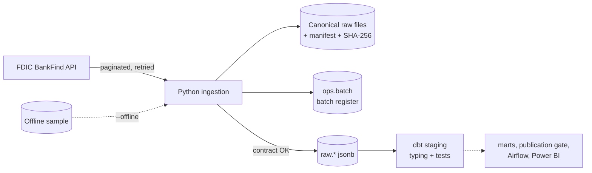

# FDIC Bank Data Warehouse

*[Version française](README.fr.md)*

This project ingests the quarterly filings of about 4,400 U.S. banks, published by the FDIC, into a PostgreSQL warehouse. Every figure can be traced back to the file and the run that loaded it. Replaying a file never duplicates data, and a quarter that fails its checks is refused while the last validated state stays untouched.

**Status (2026-11-12): week 1 of 3 is done.** Ingestion, batch register, data contract, offline sample and the dbt staging layer with its controls all run on real data. The [roadmap](#roadmap) lists what comes next.

## What is loaded

| Dataset | FDIC endpoint | Content on 2026-11-12 |
|---|---|---|
| Quarterly filings | `/financials` | 26,559 filings from 4,547 banks, Q1 2025 → Q2 2026, 19 fields |
| Institutions | `/institutions` | 27,835 institutions, active or not |
| Failures | `/failures` | 4,117 failures and assistance cases since 1934 |

The data contract ([contracts/fdic.yml](contracts/fdic.yml)) states each field's type, unit, nullability and meaning. Every field in it was checked against the live API.

## Architecture



1. **Extraction.** Pages of 1,000 rows are sorted on a stable key. On 429, 5xx and network errors the client retries with exponential backoff and honours `Retry-After`. If the FDIC rebuilds its index in the middle of a pagination, the batch is refused.
2. **Archiving.** Each batch writes a canonical JSON Lines file (same content, same bytes) and a manifest with the URL, parameters, announced total, source index version and SHA-256.
3. **Validation.** Before loading, each batch is checked for contract fields, non-empty unique keys, types and date formats, and the announced total.
4. **Loading.** If the file's hash equals the last loaded batch, the attempt is recorded as `duplicate` and nothing is loaded. Otherwise the rows are copied into `raw.*` in the same transaction as the `loaded` status.
5. **Staging (dbt).** Payloads are typed with business names and unit suffixes (`_kusd`, `_pct`) and tested.

Design choices are recorded in [docs/adr](docs/adr). The full specification (in French) is [docs/specification.fr.md](docs/specification.fr.md).

## What the real data showed

These findings come from the runs of 2026-11-12. Each one is handled in the code or the tests.

- **Units.** Amounts are in thousands of dollars: Wells Fargo's `ASSET` = 1,907,928,000 means $1.9 trillion.
- **Year-to-date income.** `NETINC` is cumulated since January 1. Wells Fargo's Q2 2026 income is 12,808,000 − 5,961,000 = 6,847,000 (thousands of dollars), not 12,808,000.
- **Published ratios match their components.** 52,769 checks (EQ / ASSET against `EQV`, LNLSNET / DEP against `LNLSDEPR`) show no gap above 0.01 point. The FDIC publishes a ratio of 0 when deposits are 0, so the 349 filings without deposits are skipped.
- **The failures key had to change.** 488 failures from 1934 to 1976 have no CERT, and 44 CERTs failed twice. The contract refused the first batch. The key is now the FDIC record ID, which cannot be requested or sorted on, so this small table is read in a single page.
- **Unmatched filers.** 57 banks (332 filings) are in `/financials` but not in `/institutions`. A dbt warning reports them until the cause is documented.
- **A quarter not yet published is refused cleanly.** Q3 2026 returned 0 rows on 2026-11-12: the batch is recorded as failed and nothing changes downstream.
- **Different date formats.** `REPDTE` is `20260630` in `/financials` and `06/30/2026` in `/institutions`. `FAILDATE` is `5/1/2026`.

## Quick start

Requirements: Python 3.12+, Docker.

```bash
python -m venv .venv
.venv/Scripts/python -m pip install -r requirements-dev.txt   # Linux/macOS: .venv/bin/python
cp .env.example .env            # then set POSTGRES_PASSWORD
docker compose up -d            # PostgreSQL 16 on 127.0.0.1:5435
```

Then, with the virtual environment's Python:

```bash
python run.py db-init                                       # ops and raw schemas
python run.py ingest financials --quarters 2025Q1:2026Q2    # one batch per quarter
python run.py ingest institutions
python run.py ingest failures
python run.py report                                        # batch register
python run.py dbt build                                     # staging models + tests
python -m pytest                                            # 39 tests
```

**Without internet**, on an empty database, load the versioned sample, built from 13 CERTs (the five largest banks, the six failures of 2025-2026 and two edge cases):

```bash
python run.py ingest all --quarters 2025Q1:2026Q2 --offline
```

## Batch register

`python run.py report` shows every attempt, including the refused ones. Excerpt from 2026-11-12:

```text
batch_id                                  status     announced  extracted  rejected  loaded
financials_20260930_20261112T192430419Z   failed     0          0          0
    error: the source announces 0 rows for this partition (not published yet?)
financials_20251231_20261112T192345626Z   duplicate  4411       4411       0         0
    same file as financials_20251231_20261112T192206917Z: nothing loaded
failures_all_20261112T192250099Z          failed     4117       4117       488
    error: row 1: key field CERT is empty; [...]
financials_20251231_20261112T192206917Z   loaded     4411       4411       0         4411
```

## Repository layout

```text
contracts/fdic.yml          data contract (fields, units, keys, ratio checks)
sql/001_init.sql            ops.batch register and raw landing tables
src/fdic_dwh/               client, sources, contract checks, pipeline, CLI
dbt/                        staging models, macros and data tests
data/sample/                offline sample (versioned); data/raw/ is not versioned
tests/                      unit, HTTP-mocked and PostgreSQL tests
docs/                       specification and architecture decision records
```

## Roadmap

- **Week 2:** history of revised values (DWH-04), dimension with history (dbt snapshot, SCD2), quarterly flows for year-to-date fields, marts, and a publication gate that swaps a `published` schema only after the tests pass (DWH-05).
- **Week 3:** Airflow DAG with per-quarter reruns, Power BI dashboard with an early-warning page built on the failures, runbook, CI, and dbt docs published on GitHub Pages.

## Data source

[FDIC BankFind Suite API](https://api.fdic.gov/banks/docs/). Public data from the U.S. Federal Deposit Insurance Corporation, no API key. The code is under the MIT license. The data is not covered by it.
