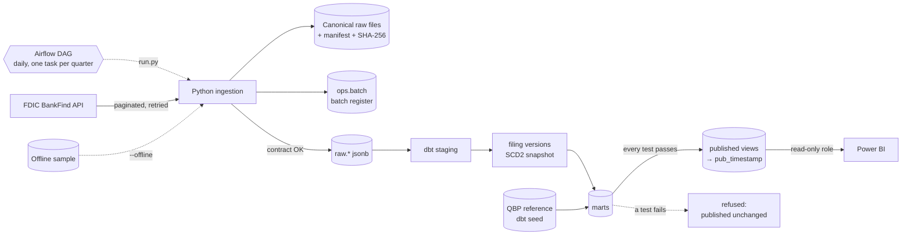

# FDIC Bank Data Warehouse


*[Version française](README.fr.md)*

This warehouse loads the quarterly filings of about 4,400 U.S. banks, published by the FDIC, into PostgreSQL. Every figure can be traced back to the file and the run that loaded it. Replaying a file never duplicates data. A revised value becomes a new version without erasing the old one. The dashboard reads only what passed every test: a build that fails leaves the last published state untouched.

## At a glance

| | |
|---|---|
| **Coverage** | 26,559 quarterly filings from 4,547 banks, Q1 2025 to Q2 2026; 27,835 institutions; 4,117 failures since 1934 |
| **Stack** | Python 3.12, PostgreSQL 16, dbt 1.12, Airflow 3.3, Power BI, Docker Compose |
| **Quality** | a data contract checked before each load, 65 dbt data tests that gate publication, 64 Python tests |
| **Reconciliation** | 12 of 12 industry checks within 0.5% of the FDIC's Quarterly Banking Profile |
| **Early warning** | 4 of the 5 bank failures of 2025-2026 carried at least two signals in their last filing |
| **Operations** | a daily Airflow run, a weekly revision window, rollback of a publication in one command |

## Documentation

| Document | Content |
|---|---|
| [dbt documentation](https://ouchchenomar.github.io/fdic-bank-data-warehouse/) | every model and column, with the lineage graph |
| [Specification](docs/specification.fr.md) | requirements, data model and acceptance criteria (French) |
| [Acceptance report](docs/recette.fr.md) | each acceptance test with its result on real data (French) |
| [Runbook](docs/runbook.fr.md) | daily operation, incidents and recovery (French) |
| [Architecture decisions](docs/adr) | four ADRs: idempotency, versions, gated publication, orchestration |
| [Changelog](CHANGELOG.md) | release notes |

## Architecture



1. **Extraction.** Pages of 1,000 rows are sorted on a stable key. On 429, 5xx and network errors the client retries with exponential backoff and honours `Retry-After`. If the FDIC rebuilds its index in the middle of a pagination, the batch is refused.
2. **Archiving.** Each batch writes a canonical JSON Lines file (same content, same bytes) and a manifest with the URL, parameters, announced total, source index version, contract version and SHA-256.
3. **Validation.** Before loading, each batch is checked against the [data contract](contracts/fdic.yml): contract fields, non-empty unique keys, types, date formats and the announced total.
4. **Loading.** If the file's hash equals the last loaded batch, the attempt is recorded as `duplicate` and nothing is loaded. Otherwise the rows are copied into `raw.*` in the same transaction as the `loaded` status.
5. **Staging (dbt).** Payloads are typed with business names and unit suffixes (`_kusd`, `_pct`) and tested.
6. **Versions (DWH-04).** Each distinct content of a filing is a version, labelled with the reason it exists:
   - `initial`: first load;
   - `contract_change`: the contract added fields, no value changed;
   - `revision`: the FDIC changed a value;
   - `simulated` and `restored_after_simulation`: a test correction and its undoing.
7. **Marts.** Facts, dimensions and reports, described in [the published data model](#published-data-model).
8. **Gated publication (DWH-05).** `run.py publish` runs `dbt build`:
   - if any test fails, the attempt is logged as `refused` and the published views do not change;
   - otherwise the marts are copied to a new schema `pub_<timestamp>`, and the views of the `published` schema are switched to it in one transaction;
   - the last three publications are kept, and `publish --rollback` goes back to the previous one.
9. **Orchestration.** An Airflow DAG runs the same `run.py` commands as an operator would, see [Operations](#operations).
10. **Dashboard.** Power BI reads the `published` views with the role `fdic_reader`, which cannot read anything else.

## Published data model

The `published` schema holds ten views. Amounts are in thousands of U.S. dollars (`_kusd`), ratios in percent (`_pct`).

| View | One row per | Content |
|---|---|---|
| `fct_filings` | bank and quarter, current version | balance sheet, income, published ratios, quarterly flows derived from year-to-date amounts, early-warning signals, lineage (batch, FDIC index version, contract version) |
| `fct_filing_versions` | distinct content of a filing | version number, reason, changed fields, source batch |
| `rpt_filing_revisions` | field changed between two versions | previous value, new value, delta |
| `dim_institution` | institution (CERT) | name, location, class, regulator, key dates |
| `dim_institution_history` | institution and period of validity | SCD2 history of the attributes, built by a dbt snapshot |
| `fct_failures` | failure since 1934 | date, estimated loss, the bank's last filing before its failure |
| `rpt_failure_signals` | filing of a failed bank before its failure | the three early-warning signals |
| `rpt_watchlist` | bank of the latest quarter with at least two signals | signals, ratios, signals of the previous quarter |
| `rpt_reconciliation_qbp` | quarter and measure | FDIC Quarterly Banking Profile against the warehouse, gap and status |
| `rpt_batches` | batch | register of every extraction attempt, with its status |

## Dashboard

`python powerbi/build_powerbi.py` generates the Power BI project from the published schema: a TMDL semantic model (9 tables, 6 relationships, 19 measures) and a PBIR report in French with four pages.

| Page | Content |
|---|---|
| Vue d'ensemble | assets, deposits and quarterly income of the sector, filters by quarter, state and asset size, the largest banks |
| Fiche établissement | one bank, reached by right-click on any bank of the other pages, then *Drill through*: each figure with its source batch, the versions of each filing and the changed values |
| Alerte précoce | the filings of failed banks before their failure, and the watch list of the latest quarter |
| Qualité et lignage | reconciliation with the Quarterly Banking Profile, batches by status, the batch register |

## Getting started

Requirements: Python 3.12 or later, Docker.

```bash
python -m venv .venv
.venv/Scripts/python -m pip install -r requirements-dev.txt   # Linux/macOS: .venv/bin/python
cp .env.example .env            # then set the passwords
docker compose up -d            # PostgreSQL 16 on 127.0.0.1:5435
```

Then, with the virtual environment's Python:

```bash
python run.py db-init                                       # ops and raw schemas, publication log
python run.py ingest financials --quarters 2025Q1:2026Q2    # one batch per quarter
python run.py ingest institutions
python run.py ingest failures
python run.py publish                                       # dbt build, then publication
python run.py report                                        # batch register
python run.py publications                                  # publication log
```

**Without internet**, on an empty database, load the versioned sample, then publish. The sample is built from 14 CERTs: the five largest banks, the six failures of 2025-2026, and three edge cases (zero deposits, zero loans, a trust company absent from `/institutions`).

```bash
python run.py ingest all --quarters 2025Q1:2026Q2 --offline
python run.py publish
```

**Power BI.** Open `powerbi/FDIC.pbip` in Power BI Desktop and refresh it with the user `fdic_reader` and the password `FDIC_READER_PASSWORD` from `.env`.

## Operations

```bash
docker compose --profile airflow up -d airflow                    # Airflow 3.3 on http://127.0.0.1:8096
docker compose exec airflow airflow dags unpause fdic_warehouse   # paused when created
```

The DAG `fdic_warehouse` runs every day at 07:00 UTC:
- it extracts the institutions, the failures, and every quarter ended since the latest one loaded, with one task per quarter;
- on Mondays it also extracts the four latest quarters again, to catch revisions;
- then it publishes, reports the batches and checks the freshness of the sources.

A quarter the FDIC has not published yet ends as *skipped*, not failed. Each task runs a `run.py` command, the same as by hand ([ADR 0004](docs/adr/0004-airflow-orchestration-of-cli-commands.md)). A run missed while the machine was off is caught up at restart, and both containers restart with Docker. Run of 2026-11-13, 53 seconds from start to end:

```text
migrate                  success
ingest_institutions      success   [duplicate] 27,835 rows, same file as the last batch: nothing loaded
ingest_failures          success   [duplicate] 4,117 rows
plan_quarters            success   ["2026Q3"]
ingest_quarter[2026Q3]   skipped   the source announces 0 rows for this partition (not published yet?)
publish                  success   [published] pub_20261113T130802855z
report, check_freshness  success
```

The [runbook](docs/runbook.fr.md) covers rerunning a quarter, replaying a batch, restoring the published state, and what each error message of the pipeline means.

## Quality and testing

- **Data contract.** [contracts/fdic.yml](contracts/fdic.yml) (version 2) states each field's type, unit, nullability and meaning. Every field was checked against the live API. A batch that breaks it is refused and recorded with the reason.
- **dbt tests.** 65 data tests run before every publication: keys, relationships, accepted values, published ratios against their components, quarterly flows that add up to the year-to-date amount, and no simulated value in the published data.
- **Python tests.** 64 tests: unit tests, an HTTP-mocked client, and PostgreSQL tests.
- **One command.** `python run.py check` runs the linter, the tests, and an offline end-to-end run (sample, dbt build, publication) in a scratch database. The GitHub Actions workflow runs the same job on demand, and pre-commit hooks lint each commit.

## Results on real data

### What the data showed

These findings come from the runs of 2026-11-12. Each one is handled in the code or the tests.

- **Units.** Amounts are in thousands of dollars: Wells Fargo's `ASSET` = 1,907,928,000 means $1.9 trillion.
- **Year-to-date income.** `NETINC` is cumulated since January 1. Wells Fargo's Q2 2026 income is 12,808,000 − 5,961,000 = 6,847,000 (thousands of dollars), not 12,808,000. `fct_filings` computes the quarterly flow.
- **Published ratios match their components.** 52,769 checks compare EQ / ASSET with `EQV` and LNLSNET / DEP with `LNLSDEPR`, and none is off by more than 0.01 point. When deposits are 0 the FDIC publishes a ratio of 0, so the 349 filings without deposits are skipped. 340 of them come from trust companies (class NC).
- **The 57 filers missing from `/institutions` are trust companies.** 57 banks (332 filings) appear in `/financials` but not in `/institutions`. All of them have class NC, mostly non-insured trust companies such as BlackRock Institutional Trust Company. Contract version 2 adds the name, state, city and class reported with each filing, and `dim_institution` uses them for these 57 CERTs.
- **Adding a field is not a revision.** After the contract change, the six quarters were reloaded and all 26,559 filings got a second version. They are labelled `contract_change` with 0 changed values, because a version is compared only on the fields present on both sides.
- **The failures key had to change.** 488 failures from 1934 to 1976 have no CERT, and 44 CERTs failed twice. The contract refused the first batch. The key is now the FDIC record ID, which cannot be requested or sorted on, so this small table is read in a single page.
- **Different date formats.** `REPDTE` is `20260630` in `/financials` and `06/30/2026` in `/institutions`. `FAILDATE` is `5/1/2026`.

### Early warning, back-tested on real failures

Each filing carries three signals (DWH-08). The thresholds are dbt variables:
- **capital**: Tier 1 leverage below 5%;
- **asset quality**: noncurrent loans above 5% of loans;
- **earnings**: a negative ROA.

`rpt_failure_signals` takes every filing of a failed bank before its failure. Five of the six failures of 2025-2026 have at least one filing in the warehouse. The sixth, Pulaski Savings Bank, failed on 2025-01-17, before the first quarter loaded.

| Bank (CERT) | Failure | Signals in its last filing | First filing with 2 signals or more |
|---|---|---|---|
| Metropolitan Capital B&T (57488) | 2026-01-30 | 2 (Q4 2025) | Q1 2025, 4 quarters before |
| Community Bank and Trust – West Georgia (25796) | 2026-05-01 | 3 (Q1 2026) | Q2 2025, 4 quarters before |
| Kentland FS&LA (28722) | 2026-07-10 | 3 (Q1 2026) | Q1 2025, 5 quarters before |
| Small Business Bank (25744) | 2026-07-17 | 2 (Q1 2026) | Q1 2026, 1 quarter before |
| Santa Anna National Bank (5520) | 2025-06-27 | 0 (Q1 2025) | none |

Community Bank and Trust is the reference case of the specification. At 2026-03-31 it shows noncurrent loans at 17.3%, equity at 1.3% of assets and an ROA of −6.9%.

In Q2 2026, the watch list (`rpt_watchlist`) holds 24 banks with at least two signals. Three of them carry all three, and seven have more signals than in the quarter before.

The screen covers insured institutions only, the population of the QBP. Foreign-bank branches (class OI) and non-insured trust companies (class NC) hold no capital of their own and report Tier 1, equity and ROA as 0. Read as values, those zeros would put Bank of China's U.S. operation on the watch list with a false capital signal.

### Reconciliation with the Quarterly Banking Profile (REC-02)

Each quarter, the FDIC publishes industry totals in its Quarterly Banking Profile (QBP). The dbt seed `qbp_reference` holds two figures from the QBP press releases for six quarters, each with its URL: the number of insured institutions and the quarterly net income. `rpt_reconciliation_qbp` compares them with the published filings:

| Quarter | Insured institutions, QBP / warehouse | Net income in $bn, QBP / warehouse |
|---|---|---|
| Q1 2025 | 4,462 / 4,462 | 70.6 / 70.41 (−0.27%) |
| Q2 2025 | 4,421 / 4,421 | 69.9 / 70.03 (+0.19%) |
| Q3 2025 | 4,379 / 4,379 | 79.3 / 79.32 |
| Q4 2025 | 4,336 / 4,338 (+2) | 77.7 / 77.66 |
| Q1 2026 | 4,278 / 4,279 (+1) | 80.5 / 80.45 |
| Q2 2026 | 4,238 / 4,238 | 90.1 / 90.20 (+0.11%) |

All 12 checks fall within the 0.5% tolerance, and 7 are equal within the published rounding. The counts match only once two classes are left out, because the QBP does not count them as insured institutions: non-insured trust companies (class NC) and insured U.S. branches of foreign banks (class OI).

### Revision and publication gate

Run on 2026-11-12 (full scenario in the [acceptance report](docs/recette.fr.md)). A simulated correction raises Wells Fargo's equity by 10% for Q2 2026 without touching the published ratio:

```text
$ python run.py simulate-revision --quarter 2026Q2 --cert 3511 --field EQ --change-pct 10
[loaded   ] financials_20260630_20261112T195337261Z  announced=4313 extracted=4313 rejected=0 loaded=4313

$ python run.py publish
[refused] pub_20261112T195338892z
            published views unchanged: pub_20261112T195245220z
            dbt build failed: assert_no_simulated_value_is_published (fail: Got 4313 results, [...]);
            assert_published_ratios_match_components (fail: Got 1 result, [...])

$ python run.py ingest financials --quarters 2026Q2        # same SHA-256 as before the simulation
$ python run.py publish
[published] pub_20261112T195413659z
```

The history keeps every step:

```text
 version | change_kind               | batch_mode | field | previous  | new       | delta
---------+---------------------------+------------+-------+-----------+-----------+-----------
       1 | initial                   | api        |       |           |           |
       2 | contract_change           | api        |       |           |           |
       3 | simulated                 | simulated  | EQ    | 169518000 | 186469800 |  16951800
       4 | restored_after_simulation | api        | EQ    | 186469800 | 169518000 | -16951800
```

### Batch register

`python run.py report` shows every attempt, including the refused ones. Excerpt from 2026-11-12:

```text
batch_id                                  status     mode       announced  extracted  rejected  loaded
financials_20260630_20261112T195405170Z   loaded     api        4313       4313       0         4313
financials_20260630_20261112T195337261Z   loaded     simulated  4313       4313       0         4313
financials_20260630_20261112T195322904Z   duplicate  api        4313       4313       0         0
    same file as financials_20260630_20261112T194225991Z: nothing loaded
financials_20260930_20261112T194315128Z   failed     api        0          0          0
    error: the source announces 0 rows for this partition (not published yet?)
failures_all_20261112T192250099Z          failed     api        4117       4117       488
    error: row 1: key field CERT is empty; [...]
```

## Known limitations

- **Coverage.** Filings start at Q1 2025. Q3 2026 was not yet published by the FDIC on 2026-11-14; the daily run loads it as soon as it is.
- **Bank-level reconciliation.** The specification also asks to check ten bank-quarters against the FFIEC Call Reports. It is not done: the FFIEC sites answered HTTP 403 from the network used for this project. The industry-level reconciliation above is complete.
- **Early warning.** The thresholds are illustrative, not a supervisory rating. A ratio screen misses a bank whose filings look healthy until it fails, as Santa Anna National Bank shows.

## Repository layout

```text
contracts/fdic.yml          data contract (fields, units, keys, ratio checks), version 2
sql/                        ops.batch register, raw landing tables, publication log, read-only role
src/fdic_dwh/               client, sources, contract checks, pipeline, simulation, publication, CLI
dbt/models/staging/         typed views over the raw payloads
dbt/models/intermediate/    filing versions, latest institutions
dbt/snapshots/              SCD2 snapshot of the institutions
dbt/models/marts/           facts, dimensions, early warning and reconciliation reports that get published
dbt/seeds/                  Quarterly Banking Profile reference figures
dbt/tests/                  ratio consistency, quarterly flows, no simulated value published
airflow/dags/               DAG fdic_warehouse
docker/airflow/             Airflow image, with the project in its own virtual environment
powerbi/                    Power BI project (TMDL model, PBIR report) and the script that generates it
data/sample/                offline sample (versioned); data/raw/ is not versioned
tests/                      unit, HTTP-mocked and PostgreSQL tests
.github/workflows/ci.yml    the run.py check job, started on demand
docs/                       specification, acceptance report, runbook and architecture decision records
```

## Data source and license

[FDIC BankFind Suite API](https://api.fdic.gov/banks/docs/): public data from the U.S. Federal Deposit Insurance Corporation, no API key. The reconciliation figures come from the FDIC's Quarterly Banking Profile press releases, listed with their URLs in [dbt/seeds/qbp_reference.csv](dbt/seeds/qbp_reference.csv).

The code is under the [MIT license](LICENSE). The data is not covered by it.
